# TravelGo – Tour & Travel Website: Complete Flowcharts & Build Spec

> Hand this file to your AI coder. Every diagram is Mermaid (renders in GitHub, VS Code with Mermaid extension, Claude, Cursor, mermaid.live).
> Stack: React + Vite, Tailwind, Supabase (Postgres, Auth, Storage, RLS), Vercel, Google Maps, React Hook Form + Zod, Recharts, Lucide React.

---

## 1. Master System Overview

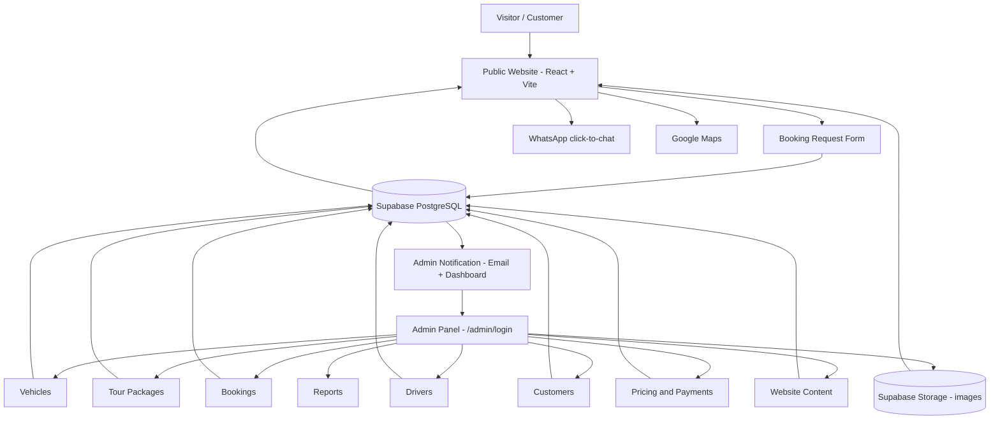

---

## 2. Public Website Sitemap & Navigation

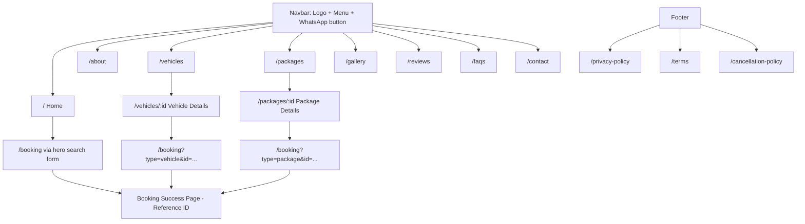

### Home page section order
1. Navbar (logo, menu)
2. Hero banner (travel themed) + booking search form
3. Why Choose Us
4. Featured vehicles
5. Popular tour packages
6. How Booking Works (4 steps)
7. Testimonials
8. Travel gallery
9. Contact + WhatsApp section
10. Footer (quick links, policies, socials)

---

## 3. Customer Booking Flow

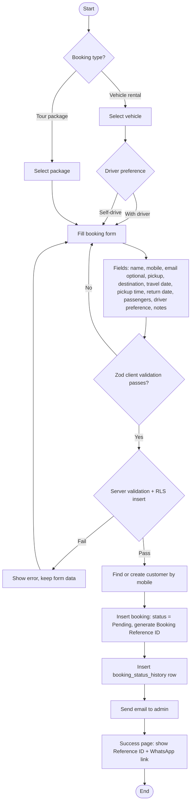

---

## 4. Admin Booking Handling Flow

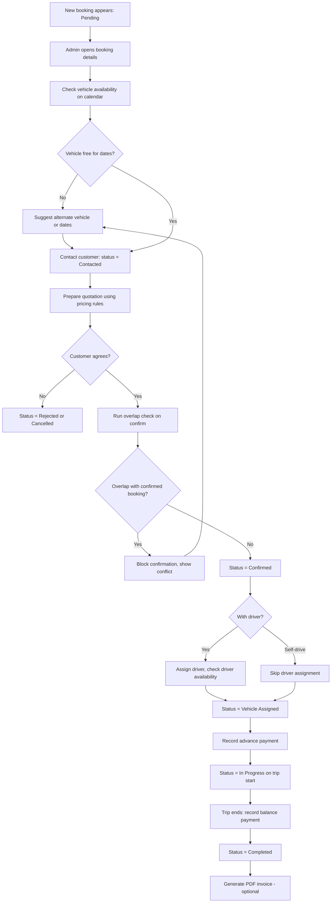

---

## 5. Booking Status State Machine

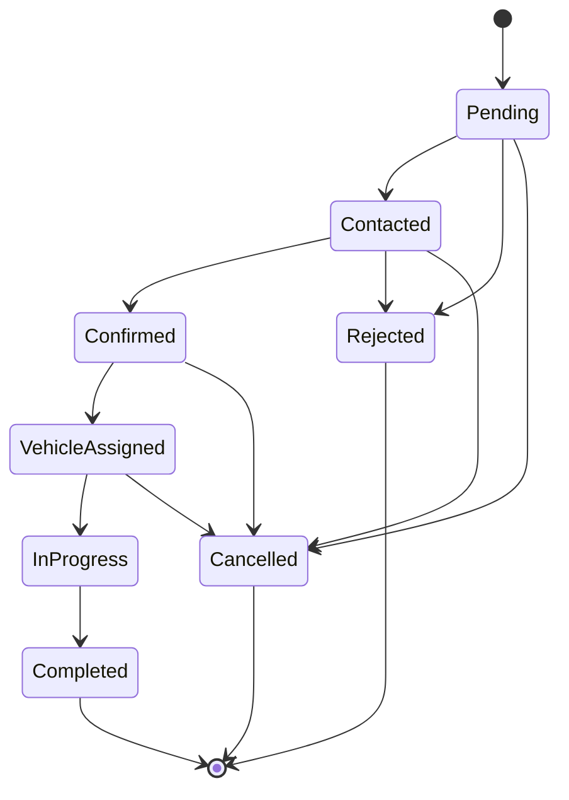

Every transition writes a row to `booking_status_history` (booking_id, old_status, new_status, changed_by, changed_at, note).

### Overlap prevention rule (implement in database, not only in UI)
- Two bookings for the same `vehicle_id` cannot both have status in (Confirmed, Vehicle Assigned, In Progress) with overlapping date ranges.
- Implement with a Postgres exclusion constraint using `btree_gist` and `daterange(travel_date, return_date, '[]')`, or a trigger that raises an error.

---

## 6. Admin Panel Structure

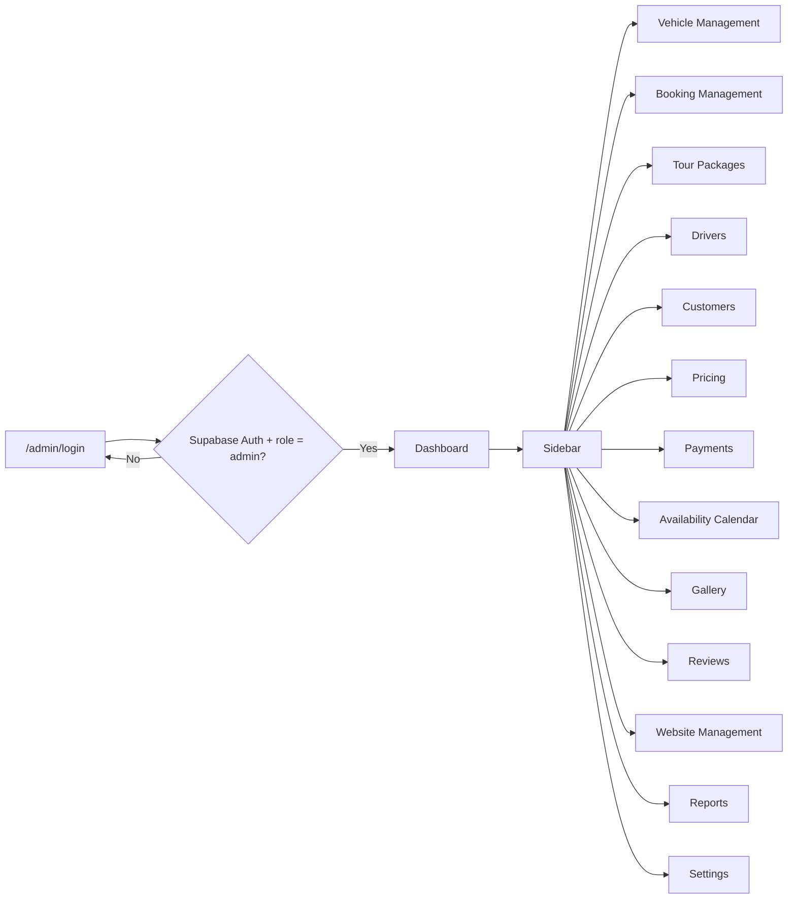

### Dashboard widgets
Total vehicles, available, unavailable, pending requests, confirmed bookings, completed trips, total recorded revenue, upcoming trips, recent enquiries, monthly bookings chart, monthly revenue chart (Recharts).

### Admin routes
`/admin/login`, `/admin`, `/admin/vehicles`, `/admin/vehicles/new`, `/admin/vehicles/:id`, `/admin/bookings`, `/admin/bookings/:id`, `/admin/packages`, `/admin/packages/new`, `/admin/packages/:id`, `/admin/drivers`, `/admin/customers`, `/admin/customers/:id`, `/admin/pricing`, `/admin/payments`, `/admin/calendar`, `/admin/gallery`, `/admin/reviews`, `/admin/website`, `/admin/reports`, `/admin/settings`

---

## 7. Vehicle Management Flow

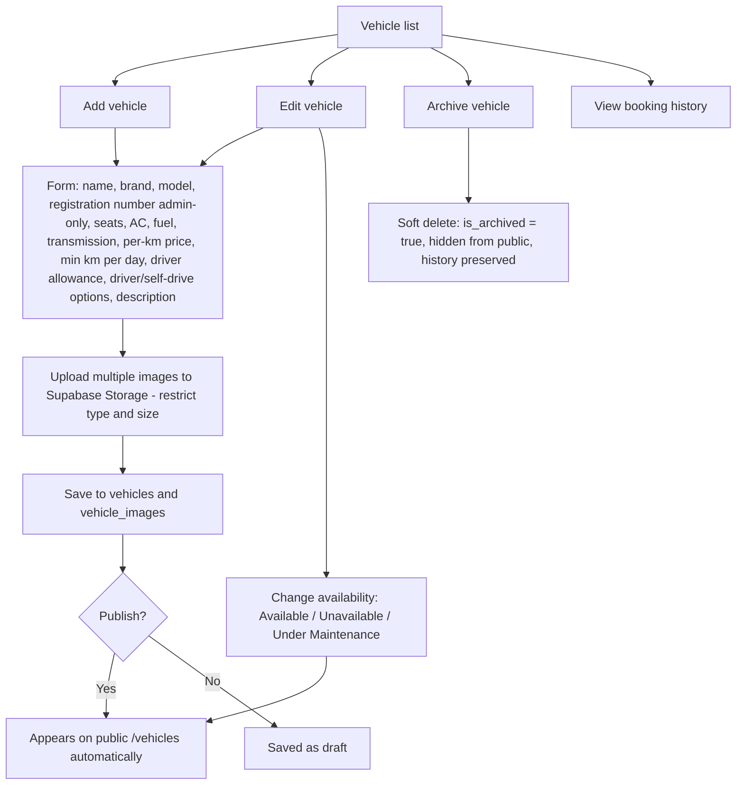

---

## 8. Tour Package Management Flow

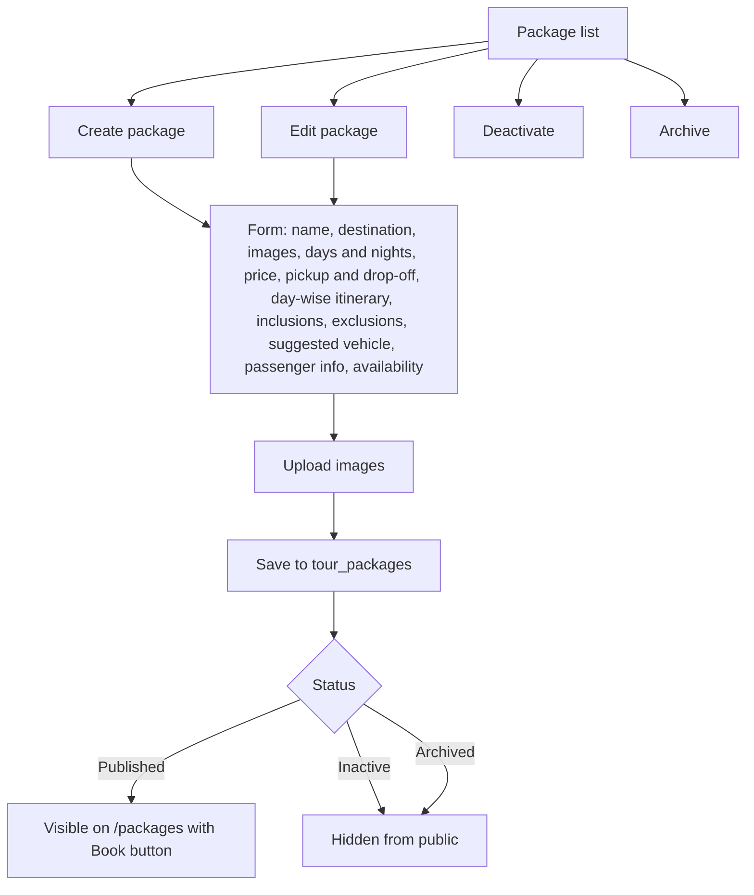

---

## 9. Pricing & Payment Flow

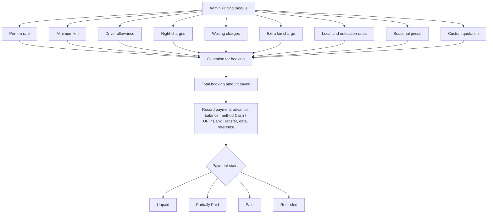

Note: no online payment gateway in v1. Payment status auto-derives from sum of payments vs total amount, with manual Refunded override.

---

## 10. Driver Management Flow

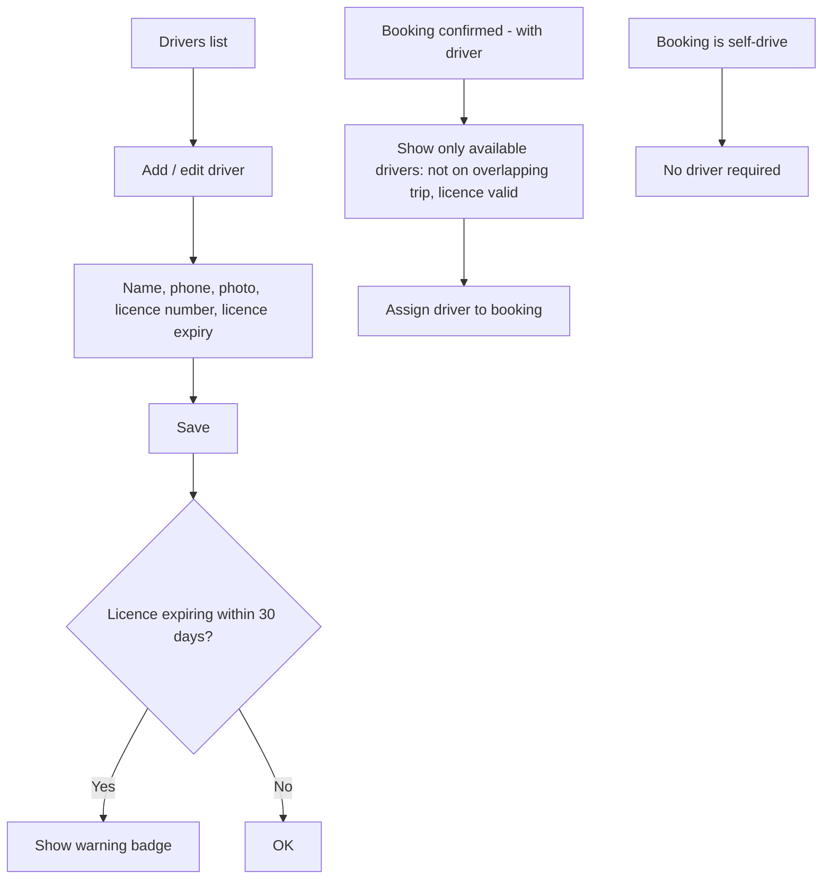

---

## 11. Website Content Management Flow

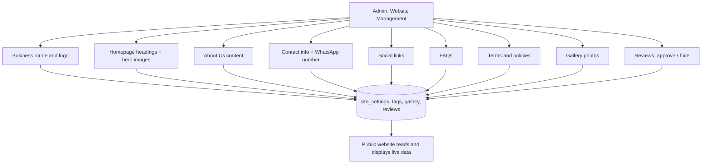

---

## 12. Authentication & Security Flow

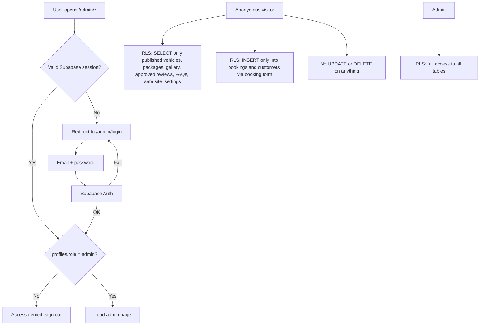

### Security checklist for the coder
- No public admin registration (disable signups; create admin manually in Supabase)
- RLS enabled on all 13 tables
- Service-role key NEVER in frontend code or Vite env vars prefixed `VITE_`
- Customers cannot set or change booking status (status forced to Pending on insert via trigger or RPC)
- Registration numbers and driver licence data never exposed to public queries (use views or column-level restrictions)
- Image uploads restricted by type (jpg, png, webp) and size (e.g. 5 MB); admin-only write on storage buckets
- Server-side validation via database constraints, checks and a booking-insert RPC
- Archived vehicles stay referenced by old bookings (soft delete, `ON DELETE RESTRICT`)

---

## 13. Database Schema (ER Diagram)

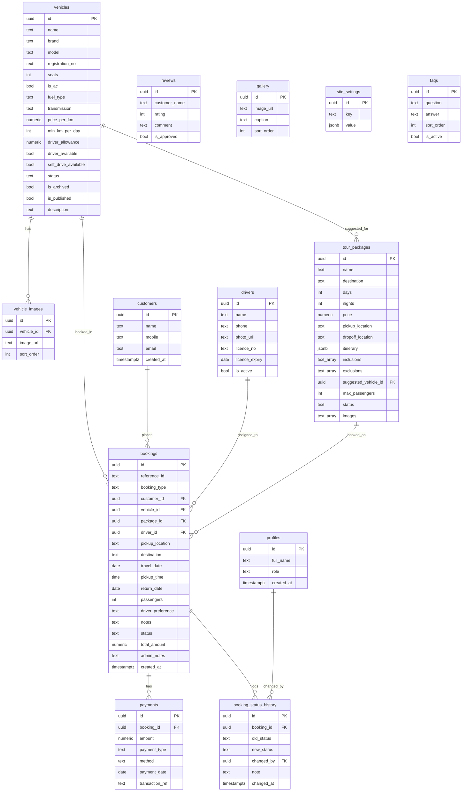

---

## 14. Frontend Folder Structure (suggested)

```
src/
  main.jsx
  App.jsx                  # routes
  lib/
    supabase.js            # client with anon key only
    validators.js          # Zod schemas
  components/
    layout/                # Navbar, Footer, AdminSidebar, ProtectedRoute
    ui/                    # Button, Card, Modal, Badge, Table
    vehicles/              # VehicleCard, VehicleForm, ImageUploader
    packages/              # PackageCard, PackageForm, ItineraryEditor
    bookings/              # BookingForm, StatusBadge, StatusTimeline
    charts/                # RevenueChart, BookingsChart
  pages/
    public/                # Home, About, Vehicles, VehicleDetails, Packages, PackageDetails,
                           # Booking, BookingSuccess, Gallery, Reviews, Contact, FAQs, Policies
    admin/                 # Login, Dashboard, Vehicles, Bookings, Packages, Drivers, Customers,
                           # Pricing, Payments, Calendar, Gallery, Reviews, Website, Reports, Settings
  hooks/                   # useAuth, useVehicles, useBookings, ...
  utils/                   # formatCurrency, generateReference, dateHelpers
```

---

## 15. Development Roadmap

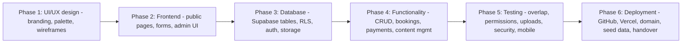

---

## 16. Step-by-Step Prompts to Give Your AI Coder

Give these one at a time, in order. Do not skip ahead.

1. **Setup:** "Create a React + Vite project with Tailwind CSS, React Router, React Hook Form, Zod, Lucide React and Recharts. Set up the folder structure from section 14 of this document."
2. **Database:** "Write the Supabase SQL migration for all 13 tables in section 13: UUID primary keys, foreign keys, check constraints for statuses, indexes, and a `btree_gist` exclusion constraint preventing overlapping active bookings for the same vehicle (section 5)."
3. **Security:** "Write RLS policies per section 12. Public can read published data and insert bookings only. Admin role has full access. Add a trigger forcing new bookings to status Pending and writing a status-history row."
4. **Storage:** "Create Supabase Storage buckets for vehicle images, package images, gallery, driver photos and logo, with admin-only write and public read, and file type and size limits."
5. **Auth:** "Build /admin/login with Supabase Auth, a ProtectedRoute that checks `profiles.role = 'admin'`, and no public signup."
6. **Public site:** "Build all public pages from section 2 with the Home section order listed there. Fetch data live from Supabase. Make it mobile-first and SEO friendly (meta tags, semantic HTML, sitemap)."
7. **Booking form:** "Build the booking form per section 3 with Zod validation, preselected vehicle or package from URL params, a Supabase insert, Booking Reference ID generation, and a success page with a WhatsApp link."
8. **Admin core:** "Build the admin layout, sidebar (section 6) and dashboard with stat cards and Recharts charts."
9. **Vehicles and packages:** "Build admin CRUD per sections 7 and 8, including multi-image upload, publish/draft, archive (soft delete) and maintenance status."
10. **Bookings:** "Build the booking management table, filters, detail page, status changes per section 5, conflict warnings, driver assignment (section 10) and admin notes."
11. **Calendar:** "Build the vehicle availability calendar showing confirmed bookings per vehicle."
12. **Pricing and payments:** "Build pricing management and payment recording per section 9 with auto-calculated payment status and balance."
13. **Drivers and customers:** "Build driver management with licence expiry warnings and customer list with booking history."
14. **Content management:** "Build Website Management per section 11 so the owner can edit all content without code."
15. **Reports and invoice:** "Build reports (monthly revenue, bookings by status, top vehicles) and a PDF invoice generator."
16. **Testing and deploy:** "Review the security checklist in section 12, test overlapping bookings, admin permissions, uploads and mobile layout, then prepare for Vercel deployment with environment variables."

---

## 17. Pending Client Inputs (placeholders to use until received)

Business name and logo, phone and WhatsApp number, address and operating area, vehicle names/models/photos, pricing structure, driver and self-drive policies, tour package details, cancellation and refund policy, email and social links. Store all of these in `site_settings` so they can be changed from the admin panel later.
